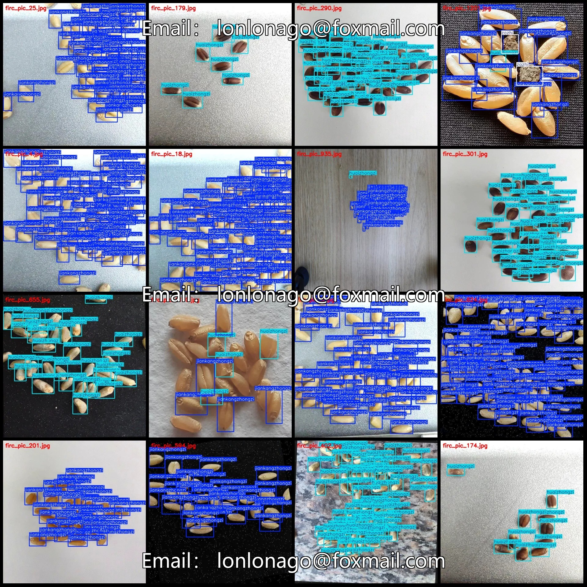
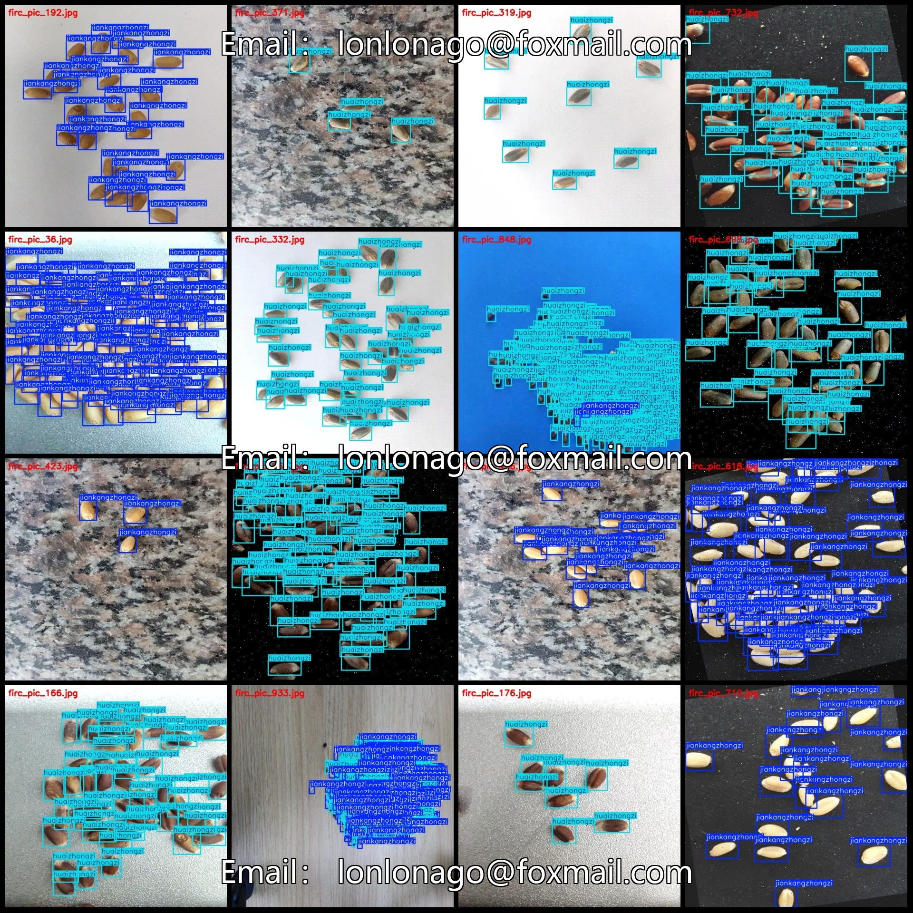
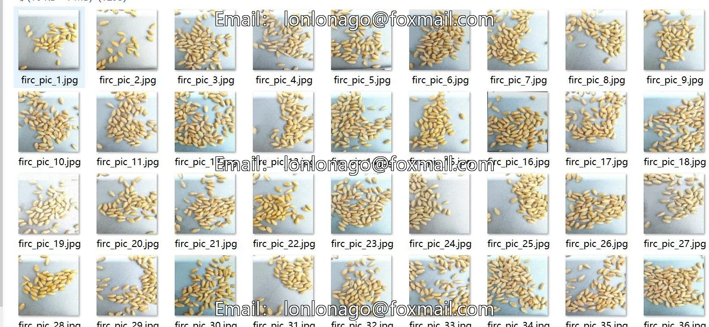
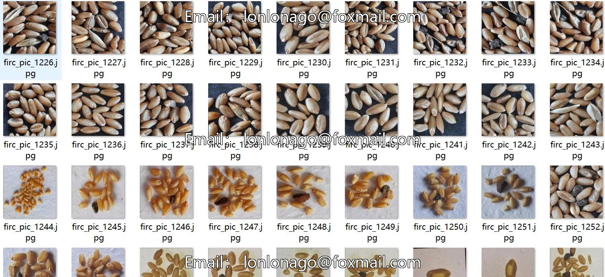
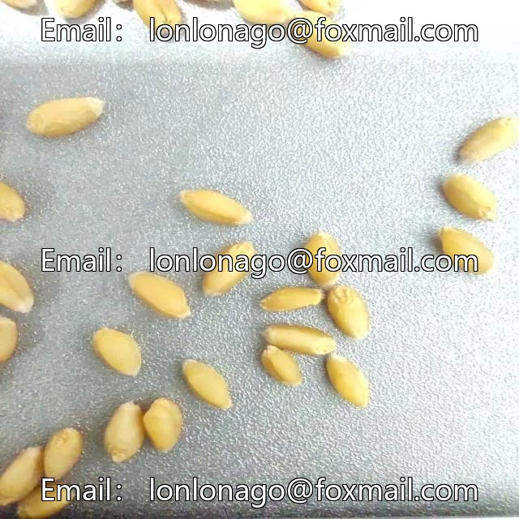
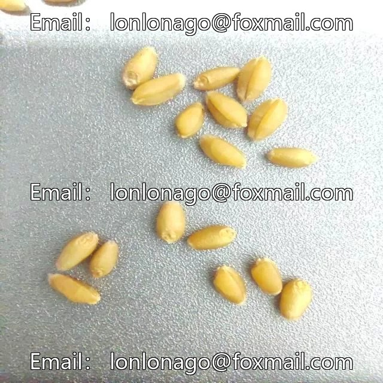
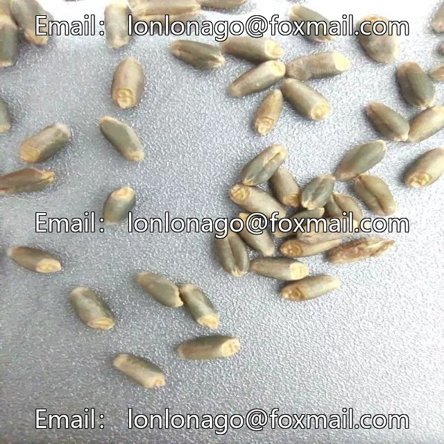

# Wheat Seed Quality Detection Dataset VOC+YOLO format with 1296 images in 3 categories

## Body

Wheat Seed Quality Detection Dataset VOC+YOLO format, 1296 images in 3 categories
Tips: Due to the dataset's replicability, please confirm compliance before purchasing.
Dataset format: Pascal VOC format + YOLO format (txt file without split path, only containing jpg images and corresponding VOC format xml files and yolo format txt files)
Number of images (number of jpg files): 1296
Number of annotations (number of xml files): 1296
Number of annotations (number of txt files): 1296
Number of annotation categories: 3

Annotation Category Names: ["Huaizhongzi", "Jiankangzhongzi", "Zazhi"]
Corresponding Chinese Category Names: ["Seed Not Good", "Healthy Seeds", "Impurities"]
Number of Boxes per Category
- Huaizhongzi = 61065
- Jiankangzhongzi = 27383
- Zazhi = 434
Total Boxes = 88882
Number of Images per Category
- Huaizhongzi = 998

Jiankangzhongzi occupies 717 images
Zazhi occupies 145 images
Image resolution: 640x640
Labeling tool used: labelImg
Labeling rules: Draw a rectangle around the category
Important note: The dataset does not have separate training, validation, and test sets; you need to partition them yourself.
Special declaration: This dataset does not guarantee the accuracy of the trained models or weight files.

## Images

## Payment

Here is a pay link on Stripe ( https://buy.stripe.com/3cs8yP7sY87d0vu9AB ). Please contact me lonlonago@foxmail.com after funding $89, and I will send you a complete data files , thank you!

